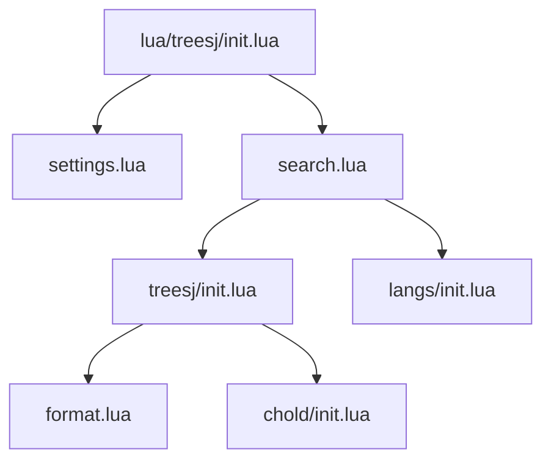

# Wansmer/treesj

> Neovim plugin to split or join code blocks (arrays, objects, statements) using Tree-sitter.

## The problem
Turning an array or an argument list from one line into several lines, and back, is done by hand and with no awareness of the syntax.

## What it actually does
Detects the Tree-sitter node under the cursor, recognizes the language (including nested ones) and splits or joins it, recursively if requested, with dot repeat. Presets exist for about forty languages (JavaScript, Python, Lua, Go, Rust, SQL, etc.) and can be customized with functions.

## How it is wired


## Trying it
```lua
return {
  'Wansmer/treesj',
  keys = { '<space>m', '<space>j', '<space>s' },
  dependencies = { 'nvim-treesitter/nvim-treesitter' },
  config = function()
    require('treesj').setup({})
  end,
}
```
Commands: `:TSJToggle`, `:TSJSplit`, `:TSJJoin`.

## Cost and gotchas
Free. Neovim 0.9 or later; nvim-treesitter is optional if the parsers are installed another way. A node with a syntax error is not formatted.

## What it is not
Not a general formatter: it does not format code outside of splitting or joining. The truncated README does not detail the end of the options.

## Alternatives
- splitjoin.vim: the original feature, usable as a fallback.

## For you
Ignore: editing comfort for Neovim users, unrelated to data, AI or MLOps work.
