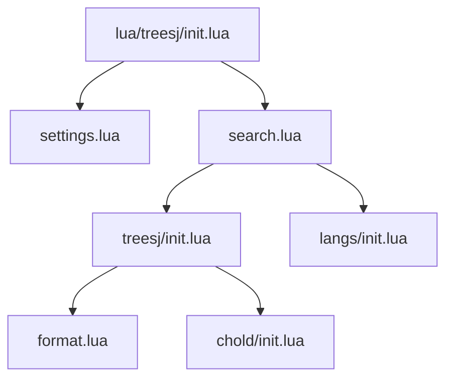

# Wansmer/treesj

> Plugin Neovim pour scinder ou joindre des blocs de code (tableaux, objets, instructions) via Tree-sitter.

## Le problème
Passer un tableau ou une liste d'arguments d'une ligne à plusieurs lignes, et inversement, se fait à la main et sans conscience de la syntaxe.

## Ce que ça fait vraiment
Détecte le nœud Tree-sitter sous le curseur, reconnaît le langage (y compris imbriqué) et le scinde ou le joint, récursivement si demandé, avec répétition par point. Des préréglages existent pour une quarantaine de langages (JavaScript, Python, Lua, Go, Rust, SQL, etc.) et se personnalisent par fonctions.

## Comment c'est branché


## Essayer
```lua
return {
  'Wansmer/treesj',
  keys = { '<space>m', '<space>j', '<space>s' },
  dependencies = { 'nvim-treesitter/nvim-treesitter' },
  config = function()
    require('treesj').setup({})
  end,
}
```
Commandes : `:TSJToggle`, `:TSJSplit`, `:TSJJoin`.

## Coût et pièges
Gratuit. Neovim 0.9 ou plus ; nvim-treesitter est optionnel si les parsers sont installés autrement. Un nœud avec erreur de syntaxe n'est pas formaté.

## Ce que ce n'est pas
Pas un formateur général : il ne met pas le code en forme hors scission ou jointure. Le README tronqué ne détaille pas la fin des options.

## Alternatives
- splitjoin.vim : fonctionnalité d'origine, utilisable en repli.

## Pour toi
Ignorer : confort d'édition pour utilisateurs de Neovim, sans lien avec un travail data, IA ou MLOps.

