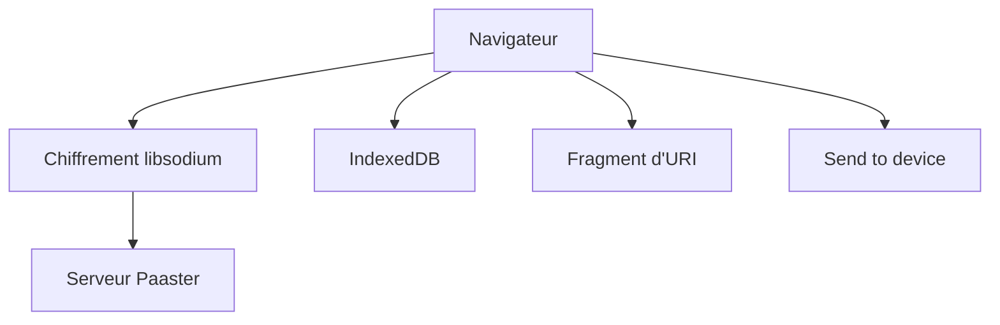

# WardPearce/paaster

> Self-hostable end-to-end encrypted pastebin, for sharing code without trusting the server.

## The problem
Classic pastebins see the content in clear text. Pasting a sensitive snippet on a third-party server exposes it.

## What it actually does
- Encrypts the paste in the browser with libsodium; the key travels in the URL fragment, never sent to the server.
- Local history, deletion after reading or after a delay, QR code, send to another device with a code valid for 5 minutes.
- Command-line tool, themes, i18n, language detection.
- No third-party dependency loaded dynamically.

## How it is wired

Simplified diagram based on the sheet, no diagram provided.

## Trying it
The README points to the documentation site for deployment; no command appears there.

## Cost and gotchas
Self-hosting: deployment is described outside the README. You must not use someone else's instance: the server could serve modified JavaScript that steals the key.

## What it is not
Not an editor: no paste editing, no optional encryption. The encryption does not protect against malicious code present at build time.

## Alternatives
No alternative named in the README.

## For you
Worth watching: handy for exchanging logs and sensitive snippets within a team, but a single maintainer and deployment docs to read separately.
