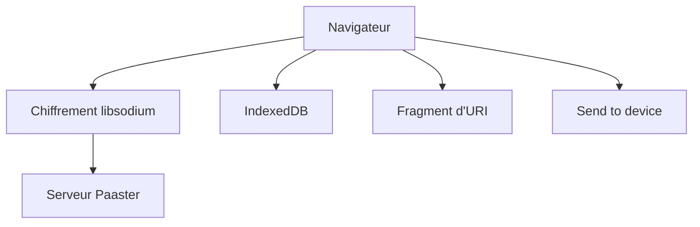

# WardPearce/paaster

> Pastebin auto-hébergeable à chiffrement de bout en bout, pour partager du code sans faire confiance au serveur.

## Le problème
Les pastebins classiques voient le contenu en clair. Coller un extrait sensible sur un serveur tiers l'expose.

## Ce que ça fait vraiment
- Chiffre le paste dans le navigateur avec libsodium ; la clé voyage dans le fragment d'URL, jamais envoyée au serveur.
- Historique local, suppression après lecture ou délai, QR code, envoi vers un autre appareil par code valable 5 minutes.
- Outil en ligne de commande, thèmes, i18n, détection de langue.
- Aucune dépendance tierce chargée dynamiquement.

## Comment c'est branché

Schéma simplifié d'après la fiche, sans diagramme fourni.

## Essayer
Le README renvoie au site de documentation pour le déploiement ; aucune commande n'y figure.

## Coût et pièges
Auto-hébergement : déploiement décrit hors README. Il ne faut pas utiliser l'instance d'un tiers : le serveur pourrait servir un JavaScript modifié qui vole la clé.

## Ce que ce n'est pas
Pas un éditeur : ni modification de paste, ni chiffrement optionnel. Le chiffrement ne protège pas contre un code malveillant présent au build.

## Alternatives
Aucune alternative nommée dans le README.

## Pour toi
À surveiller : pratique pour échanger logs et extraits sensibles en équipe, mais un mainteneur unique et une doc de déploiement à lire à part.

