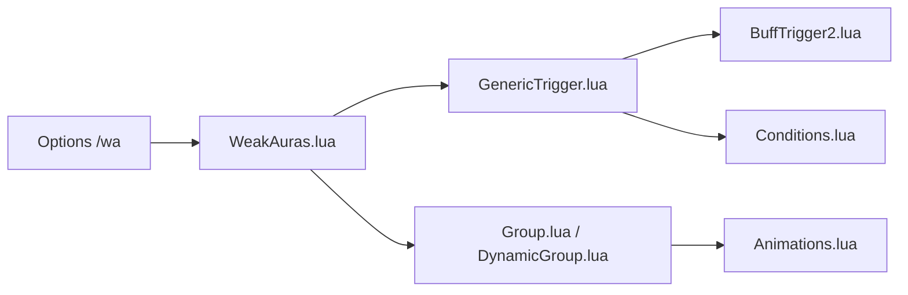

# WeakAuras/WeakAuras2

> World of Warcraft addon that displays customizable graphical alerts on the game interface.

## The problem
The WoW interface shows little information about buffs, debuffs and cooldowns.

## What it actually does
Displays icons, bars and textures triggered by auras, health, resources, cooldowns, combat events, items, totems. Animations, groups, side effects (sounds, announcements), conditional loading. For advanced users: custom Lua code. Configured with `/wa`. Sharing via wago.io and WeakAuras Companion.

## How it is wired

## Trying it
No shell command documented in the README: type `/wa` or `/weakauras` in the game.

## Cost and gotchas
Free. You need World of Warcraft (paid account on the game side).

## What it is not
Not a tool outside the game: an addon for WoW.

## Alternatives
Power Auras, which WeakAuras replaces (cited in the README).

## For you
Ignore: a game addon, no value for data/AI/MLOps.
