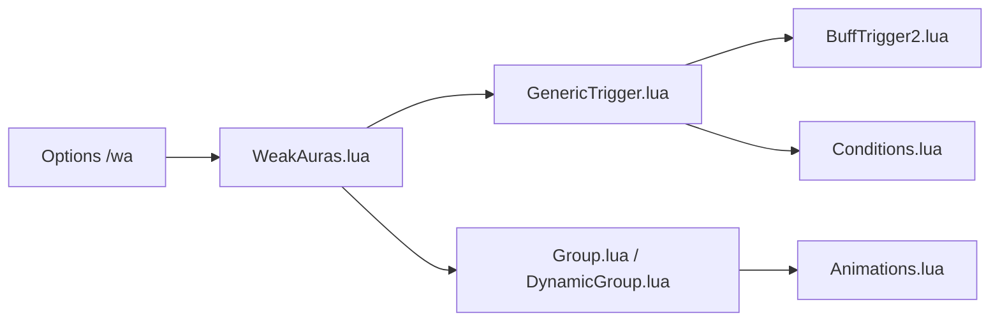

# WeakAuras/WeakAuras2

> Addon World of Warcraft pour afficher des alertes graphiques personnalisables sur l'interface du jeu.

## Le problème
L'interface de WoW montre peu d'informations sur les améliorations, affaiblissements et recharges.

## Ce que ça fait vraiment
Affiche des icônes, barres et textures déclenchées par auras, santé, ressources, recharges, événements de combat, objets, totems. Animations, groupes, effets annexes (sons, annonces), chargement conditionnel. Pour utilisateurs avancés : code Lua personnalisé. Se configure avec `/wa`. Partage via wago.io et WeakAuras Companion.

## Comment c'est branché

## Essayer
Aucune commande shell documentée dans le README : taper `/wa` ou `/weakauras` dans le jeu.

## Coût et pièges
Gratuit. Il faut World of Warcraft (compte payant côté jeu).

## Ce que ce n'est pas
Pas un outil hors du jeu : un addon pour WoW.

## Alternatives
Power Auras, que WeakAuras remplace (cité dans le README).

## Pour toi
À ignorer : addon de jeu, sans valeur pour data/IA/MLOps.

