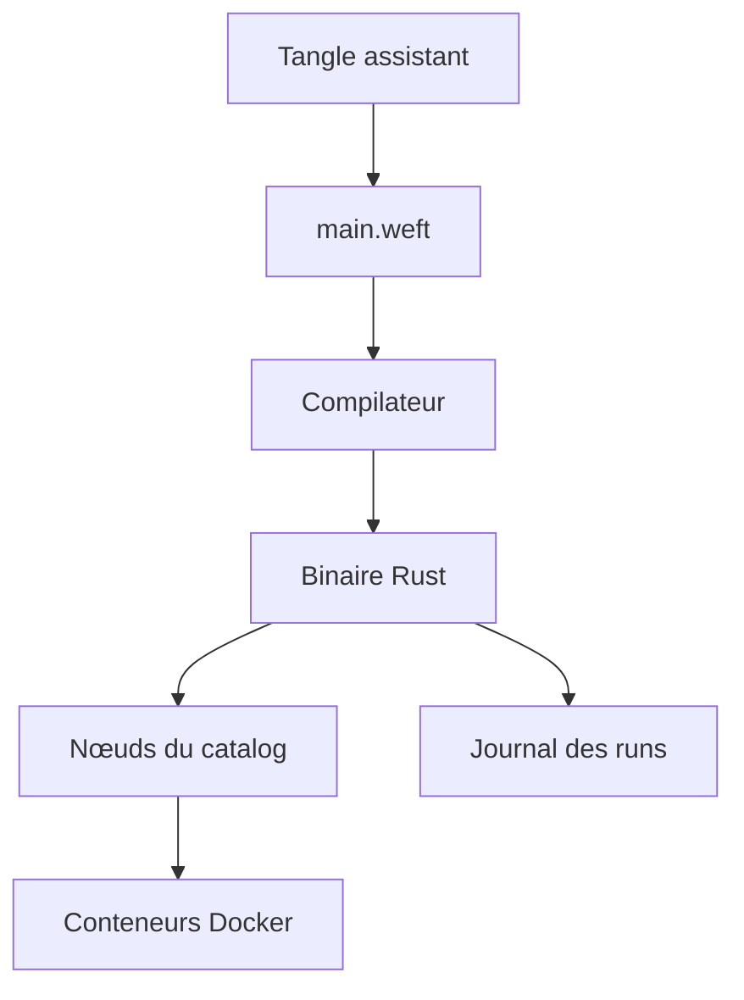

# WeaveMindAI/weft

> Compiled language and framework for orchestrating AI as graphs of typed nodes.

## The problem
A single agent that does everything is expensive and opaque; the rest of the stack (durability, observability) has to be glued back together by hand.

## What it actually does
You write a graph of nodes (LLM, human, API, database) that the compiler checks (port types, connections) and then compiles into a Rust binary. Runs are journaled, can wait for a human response and resume, and infrastructure nodes start their containers. An assistant, Tangle, writes the code.

## How it is wired
Simplified diagram based on the sheet, no diagram provided.



## Trying it
```bash
curl -fsSL https://weft.weavemind.ai/install.sh | bash
weft new hello
weft run --seed
```

## Cost and gotchas
Docker required, Rust sometimes; model providers (OpenRouter in the example) are on you. The README warns of possible breaking changes.

## What it is not
Not a mature framework: the project describes itself as early. The install script is run via `curl | bash`. License not identified by GitHub.

## Alternatives
No alternative named in the README.

## For you
Worth watching: a strong idea (verified, durable graph) but young and with an unclear license, to be reconsidered once it stabilizes.
