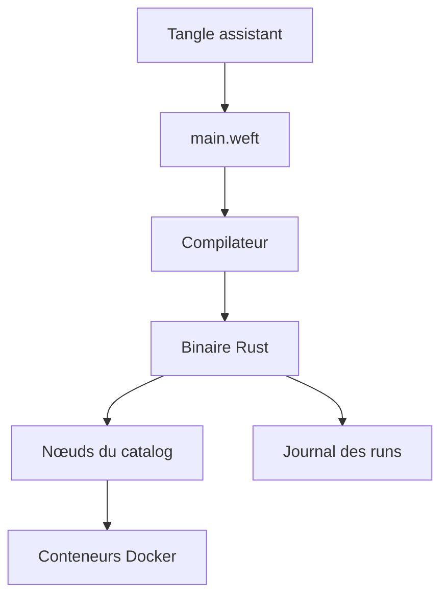

# WeaveMindAI/weft

> Langage compilé et framework pour orchestrer l'IA sous forme de graphes de nœuds typés.

## Le problème
Un agent unique qui fait tout coûte cher et reste opaque ; le reste de la pile (durabilité, observabilité) se recolle à la main.

## Ce que ça fait vraiment
On écrit un graphe de nœuds (LLM, humain, API, base) que le compilateur vérifie (types de ports, connexions) puis compile en binaire Rust. Les runs sont journalisés, peuvent attendre une réponse humaine et reprendre, et les nœuds d'infrastructure démarrent leurs conteneurs. Un assistant, Tangle, écrit le code.

## Comment c'est branché
Schéma simplifié d'après la fiche, sans diagramme fourni.



## Essayer
```bash
curl -fsSL https://weft.weavemind.ai/install.sh | bash
weft new hello
weft run --seed
```

## Coût et pièges
Docker requis, Rust parfois ; fournisseurs de modèles (OpenRouter dans l'exemple) à ta charge. Le README annonce des changements incompatibles possibles.

## Ce que ce n'est pas
Pas un framework mature : le projet se dit précoce. Le script d'installation est exécuté par `curl | bash`. Licence non identifiée par GitHub.

## Alternatives
Aucune alternative nommée dans le README.

## Pour toi
À surveiller : idée forte (graphe vérifié, durable) mais jeune et à licence floue, à reconsidérer quand elle se stabilise.

