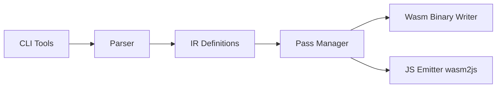

# WebAssembly/binaryen

> C++ library and tools for optimizing and compiling WebAssembly, aimed at compiler authors.

## The problem
Generating compact, fast WebAssembly from a compiler requires a dedicated optimizer and an intermediate representation close to the target format.

## What it actually does
Provides a tree-shaped IR, an optimization pass manager, a C and JavaScript API (binaryen.js) and tools: `wasm-opt`, `wasm-as`, `wasm-dis`, `wasm2js`, `wasm-merge`, `wasm-metadce`, `wasm-ctor-eval`, `wasm-reduce`. Used by Emscripten, wasm-pack, Kotlin/Wasm, Dart, AssemblyScript.

## How it is wired


## Trying it
```bash
git submodule init && git submodule update
cmake . && make
bin/wasm-opt test/lit/passes/name-types.wast -all -S -o -
```

## Cost and gotchas
Free. A C++20 compiler is required; builds are also distributed by the toolchains that embed it.

## What it is not
Not a compiler from a source language: it optimizes existing wasm. wasm2js does not reproduce all the semantics (traps).

## Alternatives
- No alternative named in the README.

## For you
Ignore: only useful if you deploy WebAssembly (for example in-browser inference), otherwise off topic.
