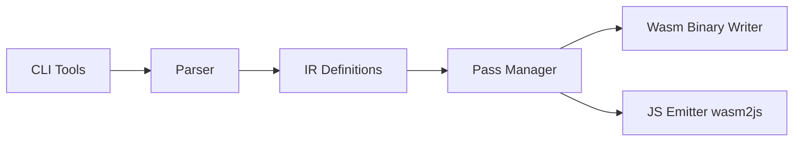

# WebAssembly/binaryen

> Bibliothèque C++ et outils pour optimiser et compiler du WebAssembly, pour auteurs de compilateurs.

## Le problème
Générer un WebAssembly compact et rapide depuis un compilateur demande un optimiseur dédié et une représentation intermédiaire proche du format cible.

## Ce que ça fait vraiment
Fournit une IR arborescente, un gestionnaire de passes d'optimisation, une API C et JavaScript (binaryen.js) et des outils : `wasm-opt`, `wasm-as`, `wasm-dis`, `wasm2js`, `wasm-merge`, `wasm-metadce`, `wasm-ctor-eval`, `wasm-reduce`. Utilisé par Emscripten, wasm-pack, Kotlin/Wasm, Dart, AssemblyScript.

## Comment c'est branché


## Essayer
```bash
git submodule init && git submodule update
cmake . && make
bin/wasm-opt test/lit/passes/name-types.wast -all -S -o -
```

## Coût et pièges
Gratuit. Compilateur C++20 requis ; les builds sont aussi distribués par les chaînes d'outils qui l'embarquent.

## Ce que ce n'est pas
Pas un compilateur depuis un langage source : il optimise du wasm existant. wasm2js ne reproduit pas toute la sémantique (traps).

## Alternatives
- Aucune alternative nommée dans le README.

## Pour toi
À ignorer : utile seulement si tu déploies du WebAssembly (par exemple inférence dans le navigateur), sinon hors sujet.

