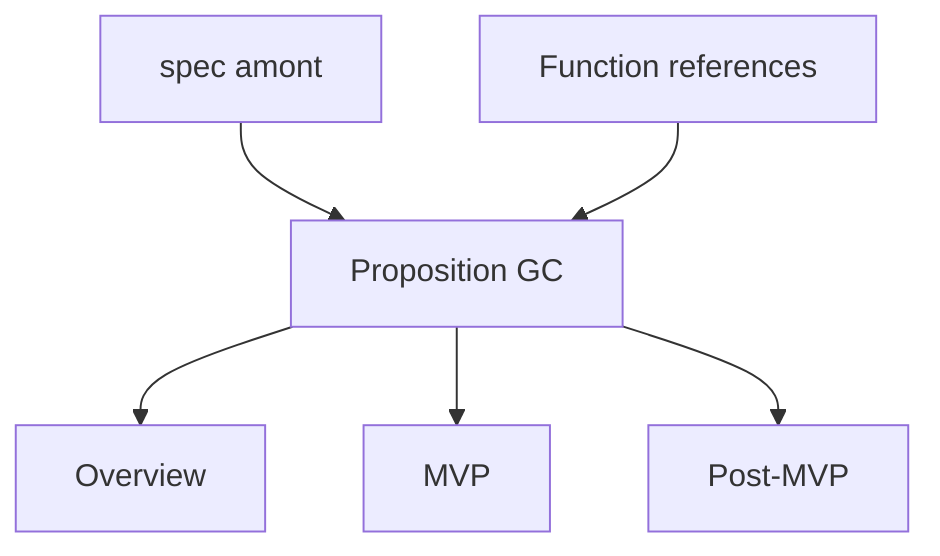

# WebAssembly/gc

> Discussion and prototype repository for adding a garbage collector to WebAssembly, for language designers.

## The problem
WebAssembly lacks native garbage collection support, which complicates compiling managed languages.

## What it actually does
It is a clone of the WebAssembly specification that serves as a proposal: overview (outdated details), MVP, post-MVP and modified specification. It builds on the function references proposal. The upstream README states that the content is "incomplete and incorrect".

## How it is wired
Simplified diagram based on the sheet, no diagram provided.

## Trying it
No command documented: read the Overview, MVP and Post-MVP documents in the repository.

## Cost and gotchas
Free. Archived repository, last push in April 2025; a license is present but not identified by GitHub.

## What it is not
Not an executable tool nor the final specification: an archived proposal workspace.

## Alternatives
The WebAssembly/spec repository, of which this one is a clone.

## For you
Ignore: archived standards proposal repository, with no direct use in data or AI.
