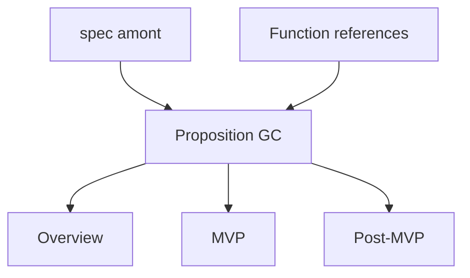

# WebAssembly/gc

> Dépôt de discussion et de prototype pour ajouter un ramasse-miettes à WebAssembly, pour concepteurs de langages.

## Le problème
WebAssembly manque d'un support natif du ramasse-miettes, ce qui complique la compilation de langages managés.

## Ce que ça fait vraiment
C'est un clone de la spécification WebAssembly qui sert de proposition : vue d'ensemble (détails périmés), MVP, post-MVP et spécification modifiée. Il repose sur la proposition des références de fonctions. Le README amont rappelle que le contenu est « incomplet et incorrect ».

## Comment c'est branché
Schéma simplifié d'après la fiche, sans diagramme fourni.

## Essayer
Aucune commande documentée : lire les documents Overview, MVP et Post-MVP du dépôt.

## Coût et pièges
Gratuit. Dépôt archivé, dernier push en avril 2025 ; licence présente mais non identifiée par GitHub.

## Ce que ce n'est pas
Pas un outil exécutable ni la spécification finale : un espace de travail de proposition, archivé.

## Alternatives
Le dépôt WebAssembly/spec, dont celui-ci est le clone.

## Pour toi
À ignorer : dépôt archivé de proposition de standard, sans usage direct en data ou IA.

