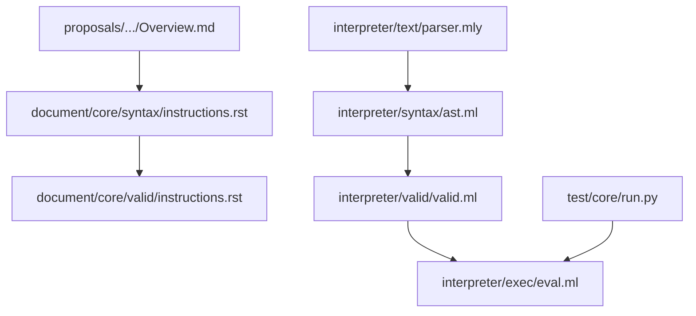

# WebAssembly/shared-everything-threads

> WebAssembly specification proposal for creating and managing threads, fork of the spec repository.

## The problem
WebAssembly has no complete model for spawning and managing threads beyond the already approved threads proposal.

## What it actually does
Draft repository: a fork of the specification with a proposal described in proposals/shared-everything-threads. The OCaml reference interpreter parses, validates and executes modules; wast tests verify the behavior.

## How it is wired


## Trying it
```bash
# Aucune commande documentée : lire proposals/shared-everything-threads/Overview.md
```

## Cost and gotchas
Nothing to pay. A license is present but not identified by GitHub. The changes from the threads proposal are not yet included.

## What it is not
Not an implementation usable in a browser: a draft standard.

## Alternatives
- WebAssembly/threads: the already approved base proposal.
- WebAssembly/spec: the upstream repository of which this one is a fork.

## For you
Watch: concerns the future of parallelism in WebAssembly, useful only if you target Wasm compute.
