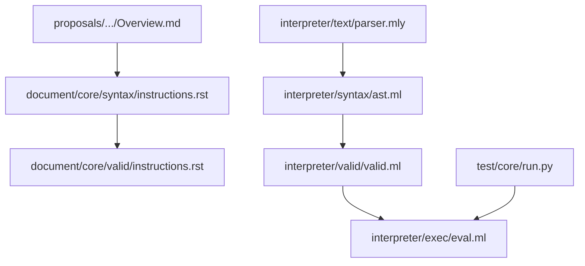

# WebAssembly/shared-everything-threads

> Proposition de spécification WebAssembly pour créer et gérer des threads, fork du dépôt spec.

## Le problème
WebAssembly n'a pas de modèle complet pour lancer et gérer des threads au-delà de la proposition threads déjà approuvée.

## Ce que ça fait vraiment
Dépôt brouillon : un fork de la spécification avec une proposition décrite dans proposals/shared-everything-threads. L'interpréteur de référence OCaml parse, valide et exécute les modules ; des tests wast vérifient le comportement.

## Comment c'est branché


## Essayer
```bash
# Aucune commande documentée : lire proposals/shared-everything-threads/Overview.md
```

## Coût et pièges
Rien à payer. La licence est présente mais non identifiée par GitHub. Les changements de la proposition threads ne sont pas encore inclus.

## Ce que ce n'est pas
Pas une implémentation utilisable dans un navigateur : un brouillon de standard.

## Alternatives
- WebAssembly/threads : proposition de base déjà approuvée.
- WebAssembly/spec : dépôt amont dont celui-ci est un fork.

## Pour toi
Surveiller : concerne l'avenir du parallélisme dans WebAssembly, utile seulement si tu cibles du calcul en Wasm.

