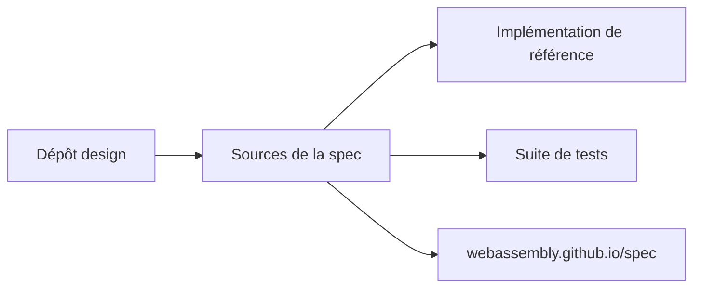

# WebAssembly/spec

> Sources of the WebAssembly specification, with a reference implementation and the official test suite.

## The problem
WebAssembly engines must agree on a precise definition of the format and semantics.

## What it actually does
The repository contains the specification sources, a reference implementation and the official test suite. The formatted version is published at webassembly.github.io/spec. Discussions of new features take place first in the "design" repository. A bibtex file is provided to cite the spec.

## How it is wired

## Trying it
No command documented in the README (short: minimal sheet). Read the published version at webassembly.github.io/spec.

## Cost and gotchas
Nothing to pay or install. Very short README: the build tooling is not described there.

## What it is not
Not a production-ready runtime nor a compiler: it is the normative reference.

## Alternatives
No alternative named in the README.

## For you
Worth watching: useful if you deploy models in the browser or in WASM and want the normative reference, otherwise irrelevant.
