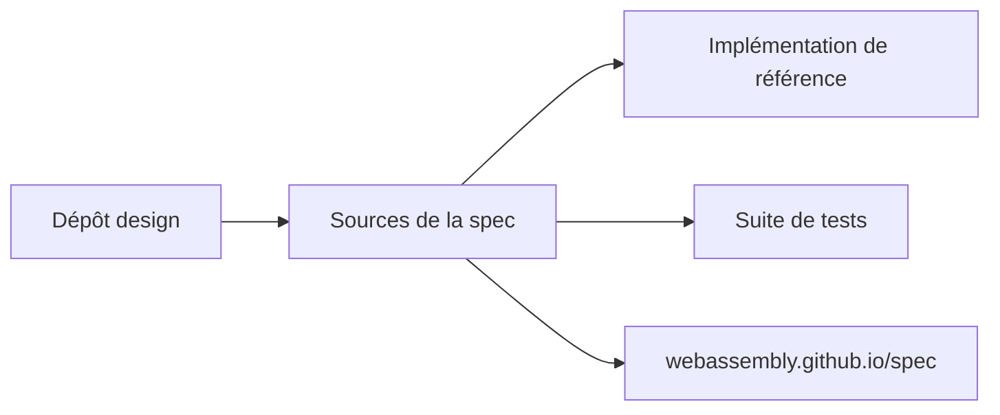

# WebAssembly/spec

> Sources de la spécification WebAssembly, avec implémentation de référence et suite de tests officielle.

## Le problème
Les moteurs WebAssembly doivent s'accorder sur une définition précise du format et de la sémantique.

## Ce que ça fait vraiment
Le dépôt contient les sources de la spécification, une implémentation de référence et la suite de tests officielle. La version formatée est publiée sur webassembly.github.io/spec. Les discussions de nouvelles fonctionnalités se font d'abord dans le dépôt « design ». Un fichier bibtex sert à citer la spec.

## Comment c'est branché

## Essayer
Aucune commande documentée dans le README (court : fiche minimale). Lire la version publiée sur webassembly.github.io/spec.

## Coût et pièges
Rien à payer ni installer. README très bref : l'outillage de build n'y est pas décrit.

## Ce que ce n'est pas
Pas un runtime utilisable en production ni un compilateur : c'est la référence normative.

## Alternatives
Aucune alternative nommée dans le README.

## Pour toi
À surveiller : utile si tu déploies des modèles dans le navigateur ou en WASM et veux la référence normative, sinon sans objet.

