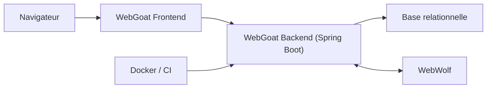

# WebGoat/WebGoat

> Deliberately vulnerable OWASP web application for learning application security through exercises.

## The problem
Learning to recognize and exploit web flaws (SQL injection, JWT, etc.) requires a safe and legal testing ground.

## What it actually does
A Spring Boot application offering interactive lessons on common flaws, along with WebWolf, a companion service (e-mails, file drop, JWT) for some exercises. A relational database keeps track of progress. Environment variables let you exclude categories or lessons.

## How it is wired


## Trying it
```shell
docker run -it -p 127.0.0.1:8080:8080 -p 127.0.0.1:9090:9090 webgoat/webgoat
docker run -p 127.0.0.1:3000:3000 webgoat/webgoat-desktop
./mvnw spring-boot:run
```

## Cost and gotchas
Free. The machine becomes very vulnerable: bind to localhost only. Some lessons require the right time zone (`TZ`). Java 25 is required to build.

## What it is not
It is not a penetration testing tool: it is the training target, to be used with ZAP or Burp. The license is present but not recognized by GitHub.

## Alternatives
No alternative named in the README.

## For you
Keep an eye on it: useful for training a team in application security before exposing model APIs, without being an everyday tool.
