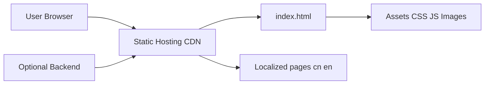

# WebStackPage/WebStackPage.github.io

> Static Bootstrap site template for a link directory, with many community back-end variants.

## The problem
Quickly publish a link-navigation site without building the front end.

## What it actually does
Static HTML pages (`cn`, `en`) with Bootstrap/Xenon assets, to be deployed on static hosting. The README mostly lists third-party variants: WordPress, Laravel, Hexo, Hugo, Jekyll, Vue, Flask, Go, Java, Typecho, and a table of sites using the template (most of them offline).

## How it is wired

## Trying it
No command: download the repo, edit the pages, deploy statically.

## Cost and gotchas
Free. Last push May 2024. A README statement warns against a paid "Webstack Pro" theme unrelated to the project.

## What it is not
Not a CMS. Not an up-to-date project: most of the listed showcase sites are offline.

## Alternatives
The listed variants (WebStack-Hugo, WebStack-Laravel, webstack-go…) add an administration back end.

## For you
Ignore: an old link-site template, nothing for data/AI.
