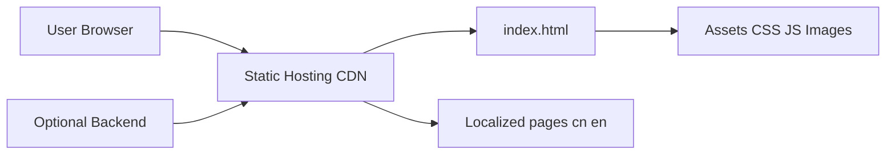

# WebStackPage/WebStackPage.github.io

> Modèle de site statique Bootstrap d'annuaire de liens, avec de nombreuses variantes de back-end communautaires.

## Le problème
Publier vite un site de navigation de liens, sans bâtir le front.

## Ce que ça fait vraiment
Pages HTML statiques (`cn`, `en`) avec assets Bootstrap/Xenon, à déployer en hébergement statique. Le README liste surtout des déclinaisons tierces : WordPress, Laravel, Hexo, Hugo, Jekyll, Vue, Flask, Go, Java, Typecho, et un tableau de sites utilisant le modèle (la plupart hors ligne).

## Comment c'est branché

## Essayer
Aucune commande : télécharger le dépôt, modifier les pages, déployer en statique.

## Coût et pièges
Gratuit. Dernier push mai 2024. Une déclaration du README met en garde contre un thème payant « Webstack Pro » sans lien avec le projet.

## Ce que ce n'est pas
Pas un CMS. Pas un projet à jour : la majorité des vitrines listées sont hors ligne.

## Alternatives
Les déclinaisons listées (WebStack-Hugo, WebStack-Laravel, webstack-go…) ajoutent un back-end d'administration.

## Pour toi
À ignorer : modèle de site de liens ancien, rien pour data/IA.

