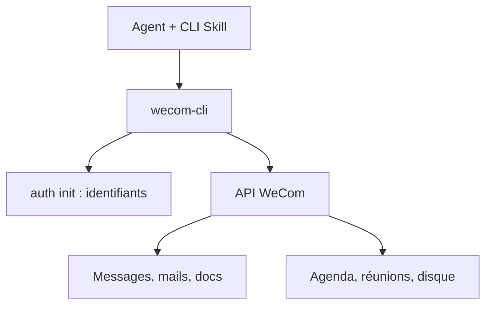

# WecomTeam/wecom-cli

> Command line for driving WeCom (messages, mail, documents, calendar, meetings, drive), meant for agents.

## The problem
Agents cannot act in WeCom (a Chinese business messaging platform) without a scriptable interface.

## What it actually does
It covers messages, mail, documents, spreadsheets, tasks, calendar, meetings, drive and directory. An agent skill is required to use it. Credentials are configured once, by QR code or manual entry. One page describes data collection.

## How it is wired
Simplified diagram based on the sheet, no diagram provided.



## Trying it
```bash
npm install -g @wecom/cli
npx skills add WeComTeam/wecom-cli -y -g
wecom-cli auth init
wecom-cli auth show
```

## Cost and gotchas
Free, but a WeCom account is required; a bot (Bot ID and Secret) is optional. Node 18+. A data collection page exists: read it before use.

## What it is not
Not a general-purpose tool: it only serves WeCom. Documentation is in Chinese.

## Alternatives
No alternative named in the README.

## For you
Ignore: useful only if your organization lives in WeCom; otherwise it has no link with data, AI or MLOps work.
