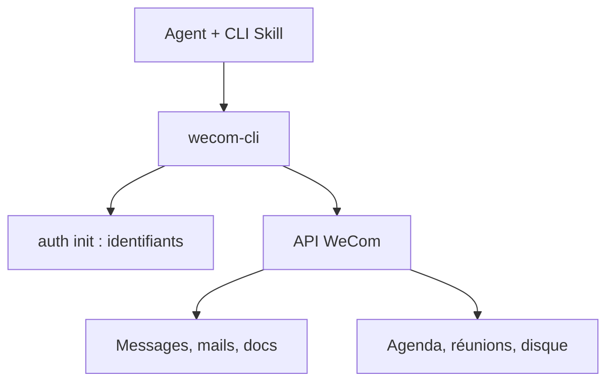

# WecomTeam/wecom-cli

> Ligne de commande pour piloter WeCom (messages, mails, documents, agenda, réunions, disque), à l'usage d'agents.

## Le problème
Les agents ne peuvent pas agir dans WeCom (messagerie professionnelle chinoise) sans interface scriptable.

## Ce que ça fait vraiment
Elle couvre messages, mails, documents, tableaux, tâches, agenda, réunions, disque et annuaire. Un skill d'agent est requis pour s'en servir. Les identifiants se configurent une fois, par QR code ou saisie manuelle. Une page décrit la collecte de données.

## Comment c'est branché
Schéma simplifié d'après la fiche, sans diagramme fourni.



## Essayer
```bash
npm install -g @wecom/cli
npx skills add WeComTeam/wecom-cli -y -g
wecom-cli auth init
wecom-cli auth show
```

## Coût et pièges
Gratuit, mais un compte WeCom est nécessaire ; un bot (Bot ID et Secret) est facultatif. Node 18+. Une page de collecte de données existe : à lire avant usage.

## Ce que ce n'est pas
Pas un outil généraliste : il ne sert que pour WeCom. Documentation en chinois.

## Alternatives
Aucune alternative nommée dans le README.

## Pour toi
À ignorer : utile seulement si ton organisation vit dans WeCom ; sinon aucun lien avec un travail data, IA ou MLOps.

