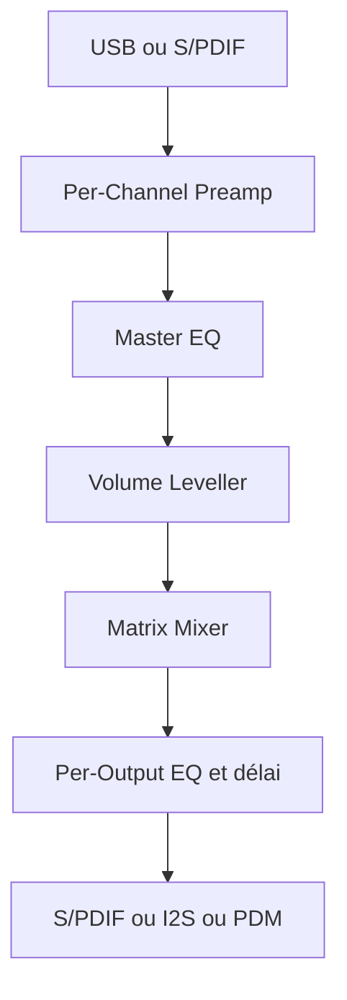

# WeebLabs/DSPi

> Firmware that turns a Raspberry Pi Pico into a USB sound card with a digital audio processor.

## The problem
Correcting a room's acoustics and doing multi-way filtering requires DSP hardware that is often expensive.

## What it actually does
The Pico appears as a USB sound card, with optional S/PDIF input and S/PDIF or I2S outputs. Processing chain: preamp, 10-band parametric equalizer, volume leveller, headphone crossfeed, mixing matrix, crossover filters (Linkwitz-Riley, Butterworth, Bessel), delays. Ten presets. The README is truncated before the end.

## How it is wired

## Trying it
No commands: flashing is done by drag and drop.
1. Download `DSPi.uf2`.
2. Plug in the Pico while holding BOOTSEL.
3. Copy the `.uf2` onto the `RPI-RP2` drive.
4. Launch the DSPi Console application.

## Cost and gotchas
Inexpensive hardware, but wiring is required (optical receiver, DAC, RC filter for the PDM output). The RP2040 inputs do not tolerate 5 V.

## What it is not
Not PC software. PDM and multiple outputs are mutually exclusive on core 1. Tuning goes through a separate application.

## Alternatives
No alternative named in the README.

## For you
Ignore: embedded audio project, unrelated to data / AI / MLOps work.
