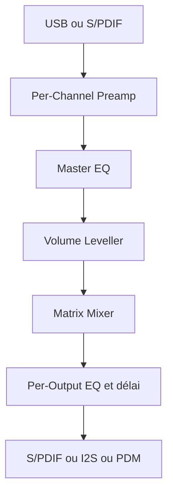

# WeebLabs/DSPi

> Firmware qui transforme un Raspberry Pi Pico en carte son USB avec processeur audio numérique.

## Le problème
Corriger l'acoustique d'une pièce et filtrer en multivoie demande du matériel DSP souvent cher.

## Ce que ça fait vraiment
Le Pico apparaît comme une carte son USB, avec entrée S/PDIF optionnelle et sorties S/PDIF ou I2S. Chaîne de traitement : préampli, égaliseur paramétrique à 10 bandes, niveleur de volume, crossfeed casque, matrice de mixage, filtres de répartition (Linkwitz-Riley, Butterworth, Bessel), délais. Dix presets. Le README est tronqué avant la fin.

## Comment c'est branché

## Essayer
Aucune commande : flashage par glisser-déposer.
1. Télécharger `DSPi.uf2`.
2. Brancher le Pico en maintenant BOOTSEL.
3. Copier le `.uf2` sur le lecteur `RPI-RP2`.
4. Lancer l'application DSPi Console.

## Coût et pièges
Matériel peu cher, mais câblage à prévoir (récepteur optique, DAC, filtre RC pour la sortie PDM). Les entrées du RP2040 ne tolèrent pas 5 V.

## Ce que ce n'est pas
Pas un logiciel pour PC. Le PDM et les sorties multiples sont exclusifs sur le cœur 1. Le réglage passe par une application séparée.

## Alternatives
Aucune alternative nommée dans le README.

## Pour toi
À ignorer : projet audio embarqué, sans lien avec un travail data / IA / MLOps.

