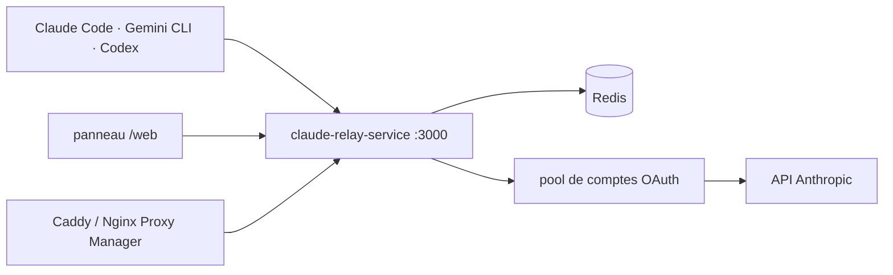

# Wei-Shaw/claude-relay-service

> Self-hosted Claude API relay service, with multi-account management and per-user keys.

## The problem
In some regions direct access to Claude Code is impossible, and third-party mirrors see
all the conversation content pass through.

## What it actually does
A Node.js + Redis service that relays requests to the Anthropic API from your own server.
It manages several Claude accounts with automatic rotation and failover, individual
API keys per user, token and cost statistics per person, a web
supervision panel, rate, concurrency, model and client limits (by User-Agent),
and HTTP/SOCKS5 proxy support. Separate routes expose the Claude, Antigravity,
Gemini, Codex and Droid pools.

## How it is wired


## Trying it
```bash
curl -fsSL https://pincc.ai/manage.sh -o manage.sh && chmod +x manage.sh && ./manage.sh install
crs start
```
```bash
export ANTHROPIC_BASE_URL="http://127.0.0.1:3000/api/"
export ANTHROPIC_AUTH_TOKEN="clé créée dans le panneau"
```

## Cost and gotchas
The README warns up front: **using this project may violate Anthropic's terms of
service**, and any risk — account ban, service interruption, other loss — is
borne by the user. Versions ≤ v1.1.248 contain a critical administrator authentication
bypass flaw allowing unauthorized access to the panel. The
install script runs via `curl | bash` from a third-party domain (`pincc.ai`). Node 18+,
Redis 6+, server outside China recommended.

## What it is not
It is not an official or approved service: the README presents it as intended for
technical learning and research. Nor is it free to use — you need one or
more Claude Max subscriptions to share, plus a server.

## Alternatives
The README points to CRS 2.0 (sub2api), a "next-generation project" to migrate to, and
mentions Claude Code Plus as an IntelliJ plugin.

## For you
Account sharing against the terms of service and the history of an authentication flaw
rule the tool out in a professional setting.
