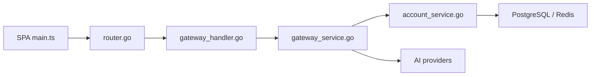

# Wei-Shaw/sub2api

> API that allows operators to purchase AI subscription quotas as API keys.

## The problem
Share subscriptions (Claude, Codex, Grok…) among multiple users with billing and usage limits.

## What it actually does
Backend Go (Gin, Ent) + Vue.js console: management of upstream accounts (OAuth, API key), key generation, scheduling with sticky sessions and failover, rate and concurrency limits, token-based billing, integrated payment (Alipay, WeChat Pay, Stripe…). Adapters for OpenAI, Anthropic, Gemini, Bedrock, and Antigravity. PostgreSQL + Redis.

## How it is wired


## Trying it
```bash
curl -sSL https://raw.githubusercontent.com/Wei-Shaw/sub2api/main/deploy/docker-deploy.sh | bash
docker compose up -d
docker compose logs -f sub2api
```

## Cost and gotchas
The README warns: Use may violate the terms of service of Anthropic and other providers; risk of account suspension at your own risk. 3,332 open issues.

## What it is not
Not a corporate-compliant LLM gateway; it's a public-facing quota-sharing tool.

## Alternatives
None specified (sub2api-mobile is an add-on).

## For you
The contractual risk is too high for professional use: it should be ignored.
