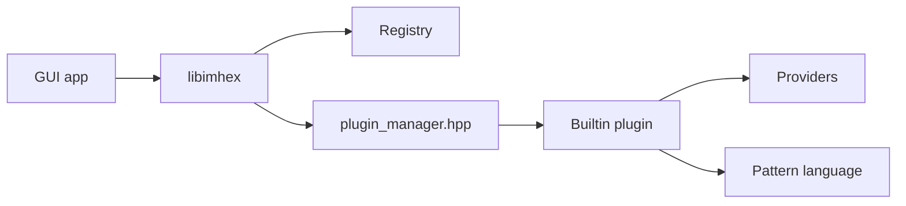

# WerWolv/ImHex

> Hex editor for reverse engineers and developers, with a pattern language, disassembler and data analysis.

## The problem
A basic hex editor does not structure an unknown binary format: you read bytes without being able to name or compare them.

## What it actually does
Hex view with patching and undo, a C++-like pattern language to describe file structures, data inspector, search, hashing, diff, disassembly via Capstone, YARA rules. Sources: files, raw disks, process memory, GDB, UDP, SFTP. Extensible through plugins.

## How it is wired


## Trying it
```bash
cmake -G Ninja -DIMHEX_BUNDLE_PLUGIN_SDK=ON -B build
```
Full build: recent GCC or Clang (C++23), `--recurse-submodules` when cloning.

## Cost and gotchas
Free. Requires OpenGL 3.0 (`-NoGPU` versions are slower). Unsigned macOS binary, macOS 15 required for releases. MSVC and AppleClang are not supported for building.

## What it is not
Not a data science tool. Not a full debugger.

## Alternatives
No alternative named in the README.

## For you
Ignore for a data/AI/MLOps profile: low-level reverse engineering tool, useful only if you inspect binary formats. GPL-2.0.
