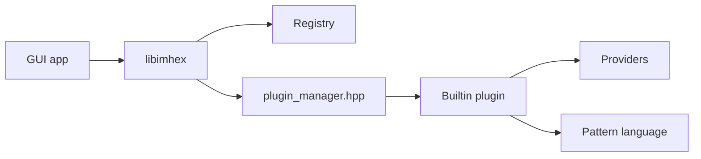

# WerWolv/ImHex

> Éditeur hexadécimal pour rétro-ingénieurs et développeurs, avec langage de motifs, désassembleur et analyse de données.

## Le problème
Un éditeur hexa basique ne structure pas un format binaire inconnu : on lit des octets sans pouvoir les nommer ni les comparer.

## Ce que ça fait vraiment
Vue hexa avec patching et undo, langage de motifs de type C++ pour décrire des structures de fichier, inspecteur de données, recherche, hachage, diff, désassemblage via Capstone, règles YARA. Sources : fichiers, disques bruts, mémoire de processus, GDB, UDP, SFTP. Extensible par plugins.

## Comment c'est branché


## Essayer
```bash
cmake -G Ninja -DIMHEX_BUNDLE_PLUGIN_SDK=ON -B build
```
Compilation complète : GCC ou Clang récent (C++23), `--recurse-submodules` au clone.

## Coût et pièges
Gratuit. Exige OpenGL 3.0 (versions `-NoGPU` plus lentes). Binaire macOS non signé, macOS 15 requis pour les releases. MSVC et AppleClang non supportés pour compiler.

## Ce que ce n'est pas
Pas un outil de data science. Pas un débogueur complet.

## Alternatives
Aucune alternative nommée dans le README.

## Pour toi
À ignorer pour un profil data/IA/MLOps : outil de reverse engineering de bas niveau, utile seulement si tu inspectes des formats binaires. GPL-2.0.

