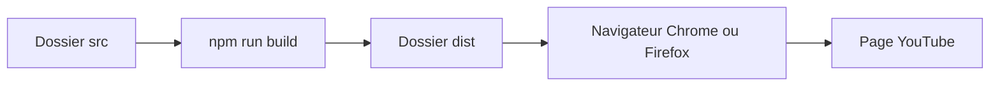

# WesselKroos/youtube-ambilight

> Browser extension that adds ambient lighting around YouTube videos.

## The problem
Watching a video on a dark page lacks visual immersion.

## What it actually does
The extension is built with Node (`npm run build`) and loaded in Chrome in developer mode or from each browser's store. The README recommends a graphics card scoring over 1000 points on the PassMark benchmark. Minimum versions: Chromium 80 and Firefox 74. The internal workings are not described.

## How it is wired
No graph provided: diagram drawn from the README.


## Trying it
```bash
npm install
npm run build
# Chrome : chrome://extensions, activer Developer mode, Load unpacked, choisir /dist
```

## Cost and gotchas
Free. Degraded performance below 1000 PassMark points. Last push about eleven months ago.

## What it is not
Not affiliated with YouTube (the brand is cited with ™). A troubleshooting guide is mentioned but not included.

## Alternatives
The README names no alternative.

## For you
Ignore: viewing comfort, unrelated to data or AI.
