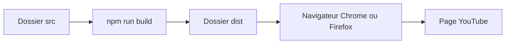

# WesselKroos/youtube-ambilight

> Extension de navigateur qui ajoute une lumière ambiante autour des vidéos YouTube.

## Le problème
Regarder une vidéo dans une page sombre manque d'immersion visuelle.

## Ce que ça fait vraiment
L'extension se compile avec Node (`npm run build`) et se charge dans Chrome en mode développeur ou depuis la boutique de chaque navigateur. Le README recommande une carte graphique de plus de 1000 points au benchmark PassMark. Versions minimales : Chromium 80 et Firefox 74. Le fonctionnement interne n'est pas décrit.

## Comment c'est branché
Pas de graphe fourni : schéma tiré du README.


## Essayer
```bash
npm install
npm run build
# Chrome : chrome://extensions, activer Developer mode, Load unpacked, choisir /dist
```

## Coût et pièges
Gratuit. Performances dégradées sous 1000 points PassMark. Dernier push il y a environ onze mois.

## Ce que ce n'est pas
Pas affilié à YouTube (la marque est citée avec ™). Un guide de dépannage est mentionné mais non inclus.

## Alternatives
Le README ne nomme pas d'alternative.

## Pour toi
Ignorer : confort de visionnage, sans lien avec la data ou l'IA.

