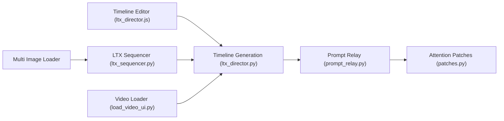

# WhatDreamsCost/WhatDreamsCost-ComfyUI

> ComfyUI nodes including a timeline editor for LTX video generation, aimed at AI video creators.

## The problem
Composing LTX videos with keyframes, per-segment prompts and audio means fiddling with many nodes without a temporal overview.

## What it actually does
- "LTX Director 2.0": timeline with prompts, start/middle/end images, audio, video, IC-LoRA, prompt relay.
- Side nodes: multi-image loader, LTX Sequencer, LTX Keyframer, speech duration calculation, video/audio loading with trimming.
- The Retake mode is flagged as beta, judged "not powerful enough" by the author.
- The author says they mostly used Gemini to write the nodes.

## How it is wired


## Trying it
```bash
cd /ComfyUI/custom_nodes/
git clone https://github.com/WhatDreamscost/WhatDreamsCost-ComfyUI
```
Or via ComfyUI Manager; update ComfyUI-LTXVideo and ComfyUI-KJNodes.

## Cost and gotchas
A GPU is required to generate. The video loader uses a lot of RAM on long outputs. 114 open issues. Documentation "coming soon".

## What it is not
Not a model nor a service: only nodes, dependent on ComfyUI-LTXVideo. Tutorials and documentation are unfinished.

## Alternatives
No alternative named in the README.

## For you
Watch: useful only if you do LTX video generation in ComfyUI; young project, single maintainer and still moving.
