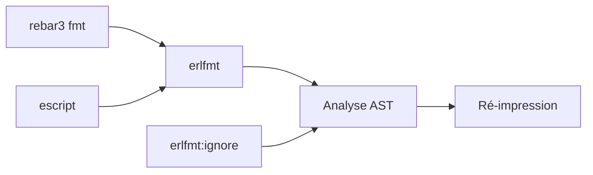

# WhatsApp/erlfmt

> Opinionated Erlang code formatter, for Erlang teams.

## The problem
Style debates and manual formatting of Erlang code.

## What it actually does
Parses the code and reprints it with a maximum width, without changing the AST. Few options, preserves the layout choices of containers and clauses, skips expressions marked `erlfmt:ignore`. Version 1.0, idempotent. rebar3 plugin or escript.

## How it is wired


## Trying it
```bash
rebar3 fmt
rebar3 fmt --check
rebar3 as release escriptize
erlfmt -w './otp/lib/*/{src,include}/*.{erl,hrl}'
```

## Cost and gotchas
Free. Erlang/OTP 21+. Line width is respected on a best-effort basis.

## What it is not
Not a linter nor a semantic fixer.

## Alternatives
rebar3_format, steamroller, erl_tidy, compared in the README (more configurable or less robust according to it).

## For you
Ignore: Erlang only, outside your data/AI/MLOps stack.
