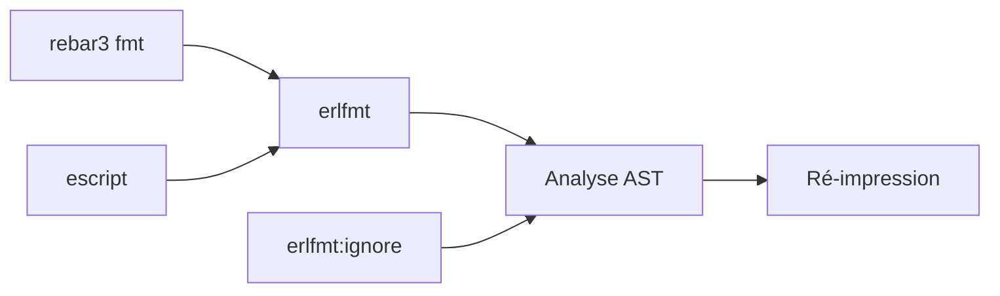

# WhatsApp/erlfmt

> Formateur de code Erlang à style imposé, pour équipes Erlang.

## Le problème
Les débats de style et le formatage manuel du code Erlang.

## Ce que ça fait vraiment
Analyse le code et le ré-imprime avec une largeur maximale, sans changer l'AST. Peu d'options, préserve les choix d'agencement des conteneurs et clauses, ignore des expressions marquées `erlfmt:ignore`. Version 1.0, idempotent. Plugin rebar3 ou escript.

## Comment c'est branché


## Essayer
```bash
rebar3 fmt
rebar3 fmt --check
rebar3 as release escriptize
erlfmt -w './otp/lib/*/{src,include}/*.{erl,hrl}'
```

## Coût et pièges
Gratuit. Erlang/OTP 21+. La largeur de ligne est respectée au mieux.

## Ce que ce n'est pas
Pas un linter ni un correcteur sémantique.

## Alternatives
rebar3_format, steamroller, erl_tidy, comparés dans le README (plus configurable ou moins robuste selon lui).

## Pour toi
À ignorer : Erlang seulement, hors de ta pile data/IA/MLOps.

