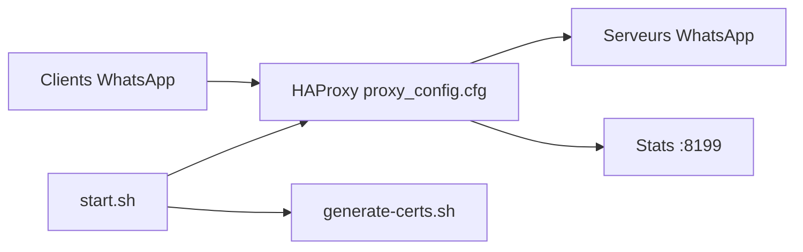

# WhatsApp/proxy

> Docker HAProxy container acting as a gateway to reach WhatsApp when the direct connection is blocked.

## The problem
On networks that block WhatsApp, clients cannot connect directly to the servers.

## What it actually does
A container runs HAProxy, which receives traffic on several ports (80, 443, 5222, 587, 7777, and ports with PROXY headers) and forwards it to WhatsApp. Self-signed certificates are generated at startup; statistics and OpenMetrics metrics on port 8199. Docker Compose, a systemd service and a Helm chart are provided.

## How it is wired


## Trying it
```bash
docker pull facebook/whatsapp_proxy:latest
docker run -it -p 80:80 -p 443:443 -p 5222:5222 -p 8080:8080 -p 8443:8443 -p 8222:8222 -p 8199:8199 -p 587:587 -p 7777:7777 whatsapp_proxy:1.0
docker compose -f /path/to/this/repo/docker-compose.yml up -d
```

## Cost and gotchas
Free, but a public IP and port forwarding are required. Expose only 443 and 587 to limit detection.

## What it is not
Not a VPN nor extra encryption: a relay for WhatsApp clients.

## Alternatives
No alternative named in the README.

## For you
Ignore: useful for getting around a network block, unrelated to data/AI/MLOps.
