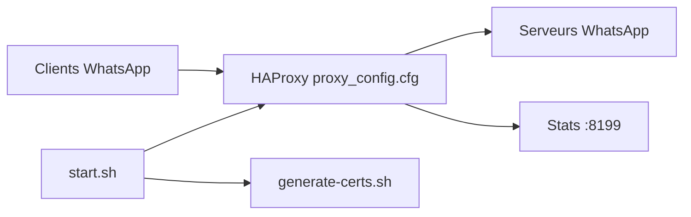

# WhatsApp/proxy

> Conteneur Docker HAProxy servant de passerelle pour joindre WhatsApp quand la connexion directe est bloquée.

## Le problème
Dans des réseaux qui bloquent WhatsApp, les clients ne peuvent pas se connecter directement aux serveurs.

## Ce que ça fait vraiment
Un conteneur lance HAProxy qui reçoit le trafic sur plusieurs ports (80, 443, 5222, 587, 7777, et ports avec en-têtes PROXY) et le transmet à WhatsApp. Les certificats auto-signés sont générés au démarrage ; statistiques et métriques OpenMetrics sur le port 8199. Docker Compose, service systemd et chart Helm sont fournis.

## Comment c'est branché


## Essayer
```bash
docker pull facebook/whatsapp_proxy:latest
docker run -it -p 80:80 -p 443:443 -p 5222:5222 -p 8080:8080 -p 8443:8443 -p 8222:8222 -p 8199:8199 -p 587:587 -p 7777:7777 whatsapp_proxy:1.0
docker compose -f /path/to/this/repo/docker-compose.yml up -d
```

## Coût et pièges
Gratuit, mais une IP publique et la redirection de ports sont nécessaires. Exposer seulement 443 et 587 pour limiter la détection.

## Ce que ce n'est pas
Pas un VPN ni un chiffrement supplémentaire : un relais pour les clients WhatsApp.

## Alternatives
Aucune alternative nommée dans le README.

## Pour toi
À ignorer : utile pour contourner un blocage réseau, sans lien avec data/IA/MLOps.

