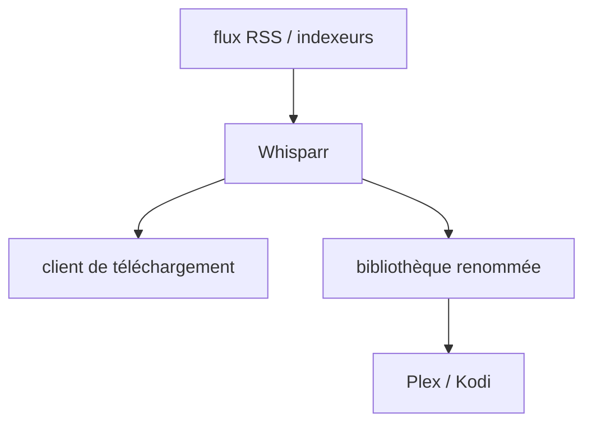

# Whisparr/Whisparr

> Adult movie collection manager, for Usenet and BitTorrent users.

## The problem
Tracking, downloading, sorting and renaming a collection by hand is tedious.

## What it actually does
Monitors RSS feeds, drives download clients and indexers, imports and renames files, and replaces a version with a better-quality one. Integrates with SABnzbd, NZBGet, qBittorrent, Plex and Kodi. One copy per movie: several instances for several qualities. Version 2.x is based on Sonarr.

## How it is wired
Simplified diagram based on the sheet, no diagram provided.

## Trying it
No command in the README: installation is described at wiki.servarr.com/whisparr/installation.

## Cost and gotchas
Free, but you need indexers, a download client and often a Usenet subscription. 264 open issues.

## What it is not
Not a media player. Adult content, to be reserved for lawful use.

## Alternatives
No alternative named in the README.

## For you
Ignore: personal media management, unrelated to data / AI / MLOps work.
