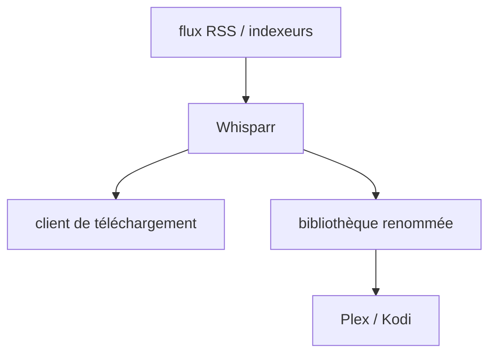

# Whisparr/Whisparr

> Gestionnaire de collection de films pour adultes, pour utilisateurs d'Usenet et de BitTorrent.

## Le problème
Suivre, télécharger, trier et renommer une collection à la main est fastidieux.

## Ce que ça fait vraiment
Surveille des flux RSS, pilote clients de téléchargement et indexeurs, importe et renomme les fichiers, et remplace une version par une meilleure qualité. Intégration SABnzbd, NZBGet, qBittorrent, Plex et Kodi. Un seul exemplaire par film : plusieurs instances pour plusieurs qualités. La version 2.x est basée sur Sonarr.

## Comment c'est branché
Schéma simplifié d'après la fiche, sans diagramme fourni.

## Essayer
Aucune commande dans le README : installation décrite sur wiki.servarr.com/whisparr/installation.

## Coût et pièges
Gratuit, mais il faut des indexeurs, un client de téléchargement et souvent un abonnement Usenet. 264 tickets ouverts.

## Ce que ce n'est pas
Pas un lecteur de médias. Contenu pour adultes, à réserver à un usage légal.

## Alternatives
Aucune alternative nommée dans le README.

## Pour toi
Ignorer : gestion de médias personnels, sans rapport avec un travail data / IA / MLOps.

