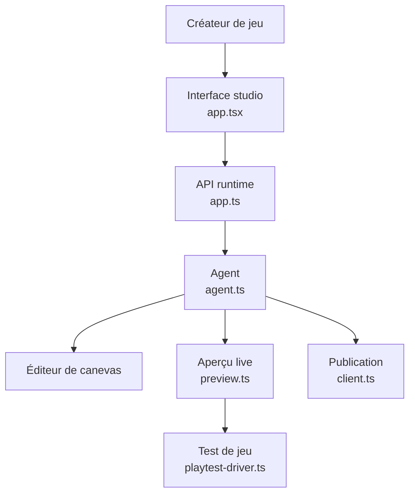

# WhiteTowerAI/ohmygame

> Desktop studio where an AI agent designs, codes, tests and publishes a game from a description.

## The problem
Creating a complete game today involves several separate tools (design, art, code, testing, publishing), which slows down fast AI-assisted prototyping.

## What it actually does
An agent writes the design document, writes the code, plays the game in a live preview to detect problems and fixes them, generates images/video/3D/audio on a single canvas, then publishes to a link playable in a browser with multiplayer rooms. Works with Claude Code, Codex, OpenCode or 40+ model providers via your own keys.

## How it is wired


## Trying it
```bash
git clone https://github.com/WhiteTowerAI/ohmygame.git
cd ohmygame
bun install --frozen-lockfile
bun run dev
```

## Cost and gotchas
In beta, expect rough edges. Requires connecting a model provider (your own key) or an existing coding agent; publishing a game requires an account. Official builds send telemetry/crash reports (can be disabled), builds compiled from source send none.

## What it is not
Not yet another game engine: it is an agent orchestration layer on top of existing engines (Godot, Unity, Unreal, Phaser, Three.js) via plugins. Not free in real use since calls to model providers are billed separately.

## Alternatives
No alternative named in the README.

## For you
Keep an eye on it as an advanced demonstration of an autonomous multimodal agent, but outside the core target of classic data/AI/MLOps unless you are interested in prototyping creative agents.
