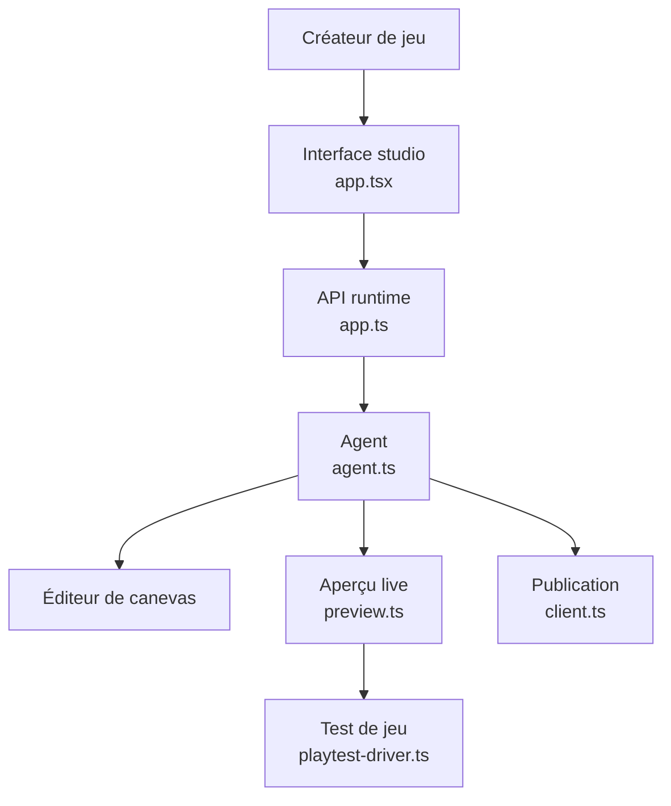

# WhiteTowerAI/ohmygame

> Studio de bureau où un agent IA conçoit, code, teste et publie un jeu à partir d'une description.

## Le problème
Créer un jeu complet mobilise aujourd'hui plusieurs outils séparés (design, art, code, test, publication), ce qui freine le prototypage rapide assisté par IA.

## Ce que ça fait vraiment
Un agent rédige le document de conception, écrit le code, joue le jeu en aperçu live pour détecter les problèmes et corrige, génère images/vidéo/3D/audio sur un même canevas, puis publie sur un lien jouable dans un navigateur avec salons multijoueurs. Fonctionne avec Claude Code, Codex, OpenCode ou 40+ fournisseurs de modèles via clés propres.

## Comment c'est branché


## Essayer
```bash
git clone https://github.com/WhiteTowerAI/ohmygame.git
cd ohmygame
bun install --frozen-lockfile
bun run dev
```

## Coût et pièges
En bêta, rodage attendu. Nécessite de connecter un fournisseur de modèle (clé propre) ou un agent de code existant ; publier un jeu requiert un compte. Les builds officiels envoient télémétrie/rapports de crash (désactivable), les builds compilées depuis les sources n'en envoient pas.

## Ce que ce n'est pas
Pas un moteur de jeu de plus : c'est une couche d'orchestration d'agent par-dessus des moteurs existants (Godot, Unity, Unreal, Phaser, Three.js) via des plugins. Pas gratuit en usage réel puisque les appels aux fournisseurs de modèles sont facturés à part.

## Alternatives
Aucune alternative nommée dans le README.

## Pour toi
À surveiller comme démonstration avancée d'agent autonome multi-modal, mais hors cœur de cible data/IA/MLOps classique sauf intérêt pour le prototypage d'agents créatifs.

