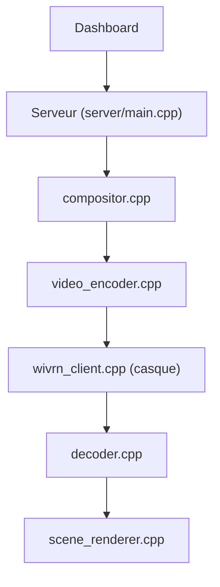

# WiVRn/WiVRn

> Free streamer of virtual reality games from a Linux PC to a standalone headset.

## The problem
Playing PC VR games on a standalone headset without going through proprietary software.

## What it actually does
A Linux server composes the frames, encodes them (NVENC, x264 or ffmpeg) and sends them over the network to the headset, which decodes and displays them. Tracking and inputs go back to the PC. A Qt dashboard guides the installation; xrizer or OpenComposite provide OpenVR compatibility.

## How it is wired


## Trying it
```bash
systemctl enable --now avahi-daemon
ufw allow 5353/udp
ufw allow 9757
systemctl --user enable --now wivrn
```

## Cost and gotchas
Free, but you need a Linux PC with a GPU, a compatible headset, Avahi and open ports (5353/UDP, 9757). Client and server must be the same version. HTC headsets are reported as stuttering.

## What it is not
Neither Windows nor non-Android headsets. The Linux client is only for debugging, without audio.

## Alternatives
No alternative named in the README (it cites xrizer and OpenComposite as compatibility layers).

## For you
Ignore: a hobby VR tool, unrelated to a data / AI / MLOps profile.
