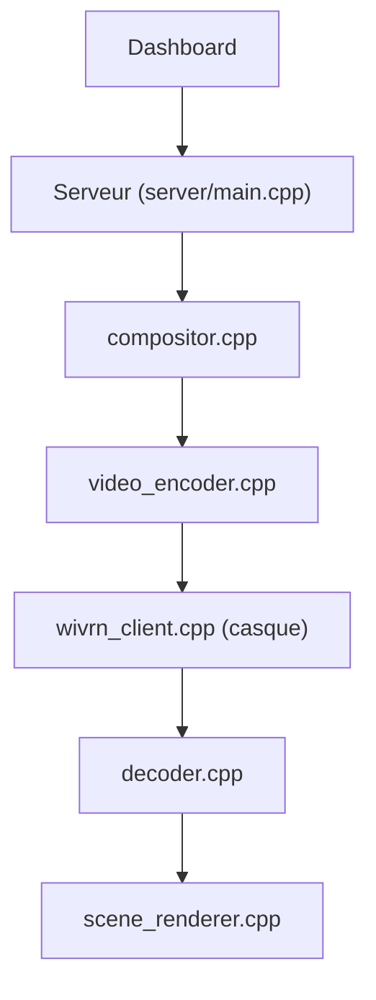

# WiVRn/WiVRn

> Diffuseur libre de jeux de réalité virtuelle depuis un PC Linux vers un casque autonome.

## Le problème
Jouer à des jeux VR du PC sur un casque autonome sans passer par un logiciel propriétaire.

## Ce que ça fait vraiment
Un serveur Linux compose les images, les encode (NVENC, x264 ou ffmpeg) et les envoie par le réseau au casque, qui décode et affiche. Le suivi et les entrées reviennent au PC. Un tableau de bord Qt guide l'installation ; xrizer ou OpenComposite assurent la compatibilité OpenVR.

## Comment c'est branché


## Essayer
```bash
systemctl enable --now avahi-daemon
ufw allow 5353/udp
ufw allow 9757
systemctl --user enable --now wivrn
```

## Coût et pièges
Gratuit, mais il faut un PC Linux avec GPU, un casque compatible, Avahi et des ports ouverts (5353/UDP, 9757). Client et serveur doivent avoir la même version. Les casques HTC sont signalés comme saccadés.

## Ce que ce n'est pas
Ni Windows ni casques non Android. Le client Linux sert seulement au débogage, sans audio.

## Alternatives
Aucune alternative nommée dans le README (il cite xrizer et OpenComposite comme couches de compatibilité).

## Pour toi
À ignorer : outil de VR de loisir, sans lien avec un profil data / IA / MLOps.

