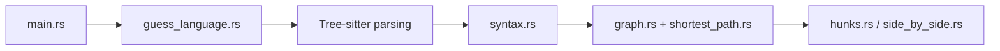

# Wilfred/difftastic

> Command-line diff tool that compares files by their syntax, not their lines.

## The problem
A line-based diff shows noise as soon as code is reformatted or reindented.

## What it actually does
Parses both files with a syntax tree parser, then looks for the shortest path in a graph (Dijkstra's algorithm) to find what really changed. Falls back to a line-based diff on parse errors. Side-by-side, inline or JSON display, git-compatible. Understands merge conflict markers.

## How it is wired


## Trying it
```bash
export DFT_PARSE_ERROR_LIMIT=20
difft foo1.c foo2.c
difft --check-only --exit-code before.js after.js
difft file_with_conflicts.js
```

## Cost and gotchas
Free. The README admits poor handling of heavily modified files (memory), sometimes confusing display, and regular releases that fix crashes. Installation: see the manual.

## What it is not
Does not generate an applicable patch: use `diff` for that. Does not merge. Does not ignore order: `set(1, 2)` and `set(2, 1)` are different.

## Alternatives
- mergiraf: syntax-tree-based merging, which difftastic does not do.
- diff: to get an applicable patch.

## For you
Adopt: useful for reviewing code or notebook changes, without heavy installation cost.
