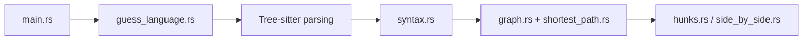

# Wilfred/difftastic

> Outil de diff en ligne de commande qui compare les fichiers selon leur syntaxe, pas leurs lignes.

## Le problème
Un diff par lignes montre du bruit dès qu'on reformate ou qu'on réindente du code.

## Ce que ça fait vraiment
Analyse les deux fichiers avec un parseur d'arbre syntaxique, puis cherche le plus court chemin dans un graphe (algorithme de Dijkstra) pour trouver ce qui a vraiment changé. Retombe sur un diff par lignes en cas d'erreur d'analyse. Affichage côte à côte, en ligne ou en JSON, compatible git. Comprend les marqueurs de conflit de fusion.

## Comment c'est branché


## Essayer
```bash
export DFT_PARSE_ERROR_LIMIT=20
difft foo1.c foo2.c
difft --check-only --exit-code before.js after.js
difft file_with_conflicts.js
```

## Coût et pièges
Gratuit. Le README avoue une mauvaise tenue sur les fichiers très modifiés (mémoire), un affichage parfois confus et des versions régulières qui corrigent des plantages. Installation : voir le manuel.

## Ce que ce n'est pas
Ne génère pas de patch applicable : utiliser `diff` pour cela. Ne fait pas de fusion. Ignore pas l'ordre : `set(1, 2)` et `set(2, 1)` sont différents.

## Alternatives
- mergiraf : fusion basée sur l'arbre syntaxique, ce que difftastic ne fait pas.
- diff : pour obtenir un patch applicable.

## Pour toi
À adopter : utile pour relire des changements de code ou de notebooks en revue, sans coût d'installation lourd.

