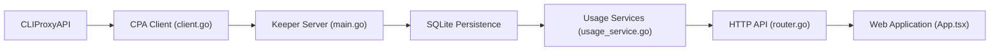

# Willxup/cpa-usage-keeper

> Dashboard that keeps in SQLite the usage statistics of a CLIProxyAPI proxy, for its users.

## The problem
CLIProxyAPI (CPA) does not durably keep its usage data; history, costs and request health are missing.

## What it actually does
Go server with a React front end: a poller fetches usage and config via CPA's management API (Redis-like stream on port 8317), stores everything in SQLite, and computes requests, tokens, cost, cache, RPM/TPM, latency. It monitors auth files and providers, refreshes quotas, syncs pricing, backs up the database, and offers an optional community leaderboard.

## How it is wired


## Trying it
```bash
cp deploy/docker-compose.example.yml docker-compose.yml
cp .env.example .env
docker compose up -d
```
Fill in `CPA_BASE_URL`, `CPA_MANAGEMENT_KEY` and `LOGIN_PASSWORD`.

## Cost and gotchas
Free. Requires a CPA instance with `usage-statistics-enabled: true`. The SQLite database and its backups contain the original data unencrypted; the service listens on all interfaces by default.

## What it is not
Does not replace a general LLM observability tool: it only talks to CLIProxyAPI. Community rankings are optional (to be enabled explicitly).

## Alternatives
No alternative named in the README.

## For you
Ignore, unless you already use CLIProxyAPI: it is an accessory to one specific proxy, not a reusable LLM tracking tool.
