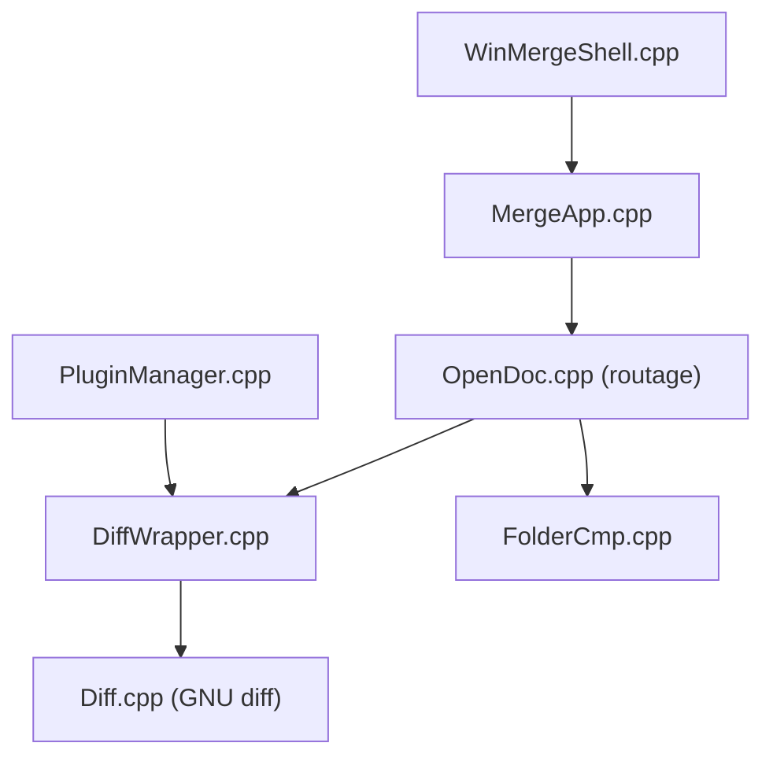

# WinMerge/winmerge

> Windows tool for comparing and merging files and folders.

## The problem
Spotting by eye the differences between two versions of files or folders is slow and unreliable.

## What it actually does
Compares two or three text files, and folders, with filters, syntax highlighting, merging, patch creation and archives via 7-Zip. Integration with Windows Explorer. Specialized views: hexadecimal, image, web page. Extensible plugins and filters. Developed since 2000.

## How it is wired


## Trying it
```bash
git clone --recurse-submodules https://github.com/winmerge/winmerge
cd winmerge
DownloadDeps.cmd
BuildAll.cmd [x86|x64|ARM64]
```

## Cost and gotchas
Free. Windows only. Building requires Visual Studio, Inno Setup, 7-Zip, Python, Pandoc and MSYS2. The README gives no command to install the binary.

## What it is not
Not cross-platform. Not a version control tool.

## Alternatives
No alternative named in the README.

## For you
Ignore: a Windows file comparison tool; your Git workflow is enough on Linux, only useful if you work on Windows.
