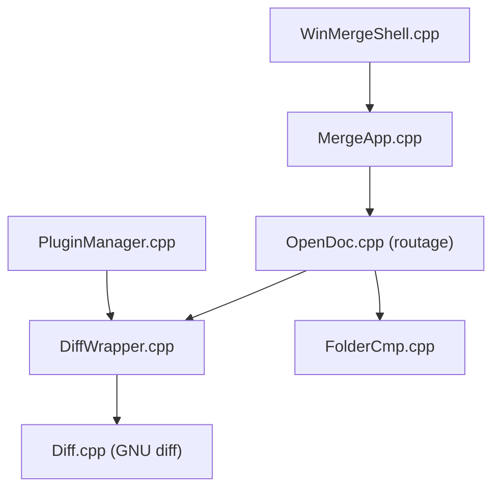

# WinMerge/winmerge

> Outil Windows de comparaison et de fusion de fichiers et de dossiers.

## Le problème
Repérer à l'œil les différences entre deux versions de fichiers ou de dossiers est lent et incertain.

## Ce que ça fait vraiment
Compare deux ou trois fichiers texte, des dossiers, avec filtres, coloration syntaxique, fusion, création de patchs et archives via 7-Zip. Intégration à l'Explorateur de Windows. Vues spécialisées : hexadécimal, image, page web. Plugins et filtres extensibles. Développé depuis 2000.

## Comment c'est branché


## Essayer
```bash
git clone --recurse-submodules https://github.com/winmerge/winmerge
cd winmerge
DownloadDeps.cmd
BuildAll.cmd [x86|x64|ARM64]
```

## Coût et pièges
Gratuit. Windows uniquement. La compilation demande Visual Studio, Inno Setup, 7-Zip, Python, Pandoc et MSYS2. Le README ne donne pas de commande d'installation du binaire.

## Ce que ce n'est pas
Pas multiplateforme. Pas un outil de contrôle de version.

## Alternatives
Aucune alternative nommée dans le README.

## Pour toi
À ignorer : comparateur de fichiers Windows ; ton flux Git suffit sous Linux, utile seulement si tu travailles sous Windows.

