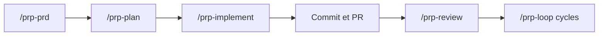

# Wirasm/PRPs-agentic-eng

> Collection of Claude Code skills that turn a request into a PRD, plan, implementation and PR.

## The problem
A coding agent delivers better with precise context, patterns from the existing code and validation commands than with a vague request.

## What it actually does
A "Product Requirement Prompt" combines a PRD, code context and a user guide for the agent. Skills provided: `/prp-prd`, `/prp-plan`, `/prp-implement`, `/prp-review`, `/prp-commit`, `/prp-debug`, and `/prp-loop` which chains plan, implementation, PR and reviews in `claude -p` sessions. Artifacts are stored under `~/.prp/<project>/`.

## How it is wired


## Trying it
```bash
/plugin marketplace add Wirasm/PRPs-agentic-eng
/plugin install prp-core@prp-marketplace
/prp-loop "add user authentication with JWT" --until implement
```

## Cost and gotchas
Free, but each loop consumes Claude Code sessions (limits: 3 cycles, 10 implementation iterations by default). Parallel git worktrees are recommended.

## What it is not
Not software: these are Markdown prompts. The README contains an advertisement for paid workshops. The provided architecture diagram describes an older version (`prp_runner.py`) and diverges from the current README.

## Alternatives
No alternative named in the README.

## For you
Worth watching: a useful method for framing a coding agent, but a single-person repo with no declared license.
