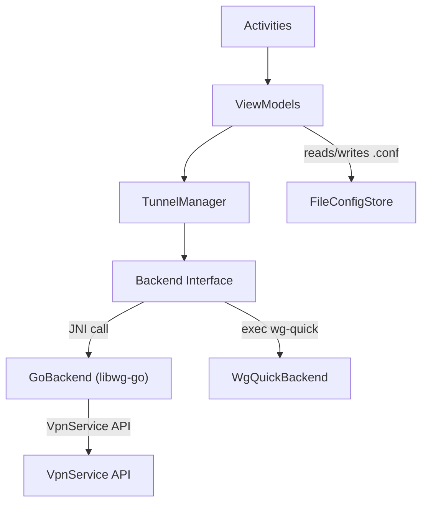

# WireGuard/wireguard-android

> Official Android application for WireGuard, with a tunnel library reusable by other applications.

## The problem
Connecting to a WireGuard VPN from a phone requires a client that manages configuration files, tunnels and automatic startup.

## What it actually does
Uses the kernel implementation when available, otherwise the userspace implementation (libwg-go) without root. The ui module (Kotlin) imports .conf files via FileConfigStore and drives tunnels via TunnelManager, a quick-settings tile and a boot receiver. The tunnel module is published on Maven Central.

## How it is wired


## Trying it
```bash
git clone --recurse-submodules https://git.zx2c4.com/wireguard-android
cd wireguard-android
./gradlew assembleRelease
```
Otherwise, install from the Play Store.

## Cost and gotchas
Free. The wg-quick backend requires root; the library requires Java 17 and Java 8 desugaring. On macOS, flock(1) may be missing for the build.

## What it is not
Neither a WireGuard server nor a VPN provider: you must already have a peer to join.

## Alternatives
No alternative named in the README.

## For you
Watch: reliable reference if you reach your infrastructure (GPU, cluster) from a phone via WireGuard, otherwise irrelevant.
