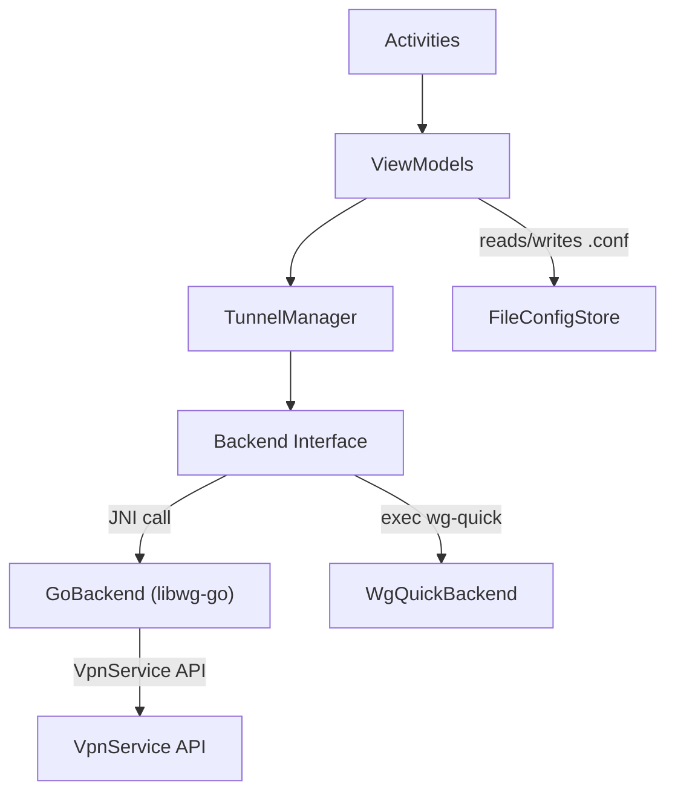

# WireGuard/wireguard-android

> Application Android officielle pour WireGuard, avec une bibliothèque de tunnel réutilisable par d'autres applications.

## Le problème
Se connecter à un VPN WireGuard depuis un téléphone demande un client qui gère les fichiers de configuration, les tunnels et le démarrage automatique.

## Ce que ça fait vraiment
Utilise l'implémentation noyau quand elle existe, sinon l'implémentation en espace utilisateur (libwg-go) sans root. Le module ui (Kotlin) importe des fichiers .conf via FileConfigStore et pilote les tunnels via TunnelManager, une tuile de réglages rapides et un récepteur de démarrage. Le module tunnel est publié sur Maven Central.

## Comment c'est branché


## Essayer
```bash
git clone --recurse-submodules https://git.zx2c4.com/wireguard-android
cd wireguard-android
./gradlew assembleRelease
```
Sinon, installation depuis le Play Store.

## Coût et pièges
Gratuit. Le backend wg-quick demande le root ; la bibliothèque exige Java 17 et le désucrage Java 8. Sous macOS, flock(1) peut manquer pour le build.

## Ce que ce n'est pas
Ce n'est ni un serveur WireGuard, ni un fournisseur de VPN : il faut déjà disposer d'un pair à rejoindre.

## Alternatives
Aucune alternative nommée dans le README.

## Pour toi
À surveiller : référence fiable si tu atteins ton infra (GPU, cluster) depuis un téléphone via WireGuard, sinon sans objet.

