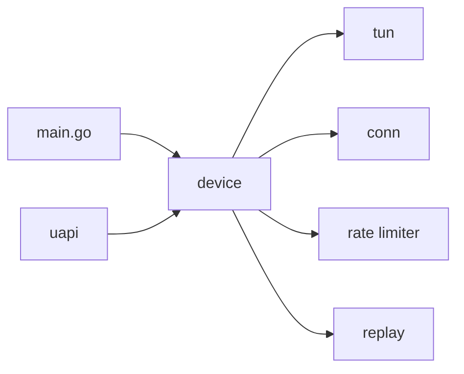

# WireGuard/wireguard-go

> Userspace Go implementation of WireGuard, for platforms without a kernel module.

## The problem
Using WireGuard tunnels on systems where the kernel module is not available.

## What it actually does
A process creates a virtual interface (`tun`), exchanges encrypted UDP packets (`conn`) and runs the protocol state machine (`device`), with peers, allowed IPs and the Noise handshake. The `ipc` package exposes the UAPI interface for `wg(8)`. Dedicated packages handle anti-replay and rate limiting.

## How it is wired


## Trying it
```bash
git clone https://git.zx2c4.com/wireguard-go
cd wireguard-go
make
wireguard-go wg0
wireguard-go -f wg0
```

## Cost and gotchas
Free. On Linux, the README recommends the kernel module, which is faster. macOS, FreeBSD and OpenBSD lack sticky sockets.

## What it is not
It is not the complete application: on Windows, it serves as a module for the official app.

## Alternatives
- WireGuard kernel module on Linux: faster and better integrated (according to the README).

## For you
Worth watching: a reference building block for linking machines or GPU clusters in a private network, with no direct data/AI use.
