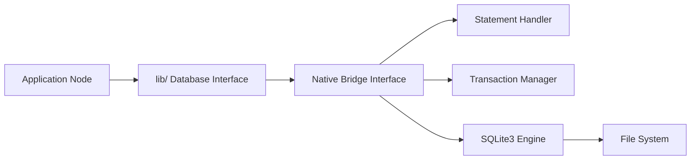

# WiseLibs/better-sqlite3

> Fast, synchronous SQLite binding for Node.js.

## The problem
`node-sqlite3` is asynchronous for serialized tasks: slow, heavy, with C-style memory management.

## What it actually does
A synchronous API: `db.prepare(...).get/all/run`, full transactions.
User-defined functions, aggregates and virtual tables, plus extension loading.
64-bit integers and worker threads for slow queries.
Precompiled binaries for major platforms.

## How it is wired


## Trying it
```bash
npm install better-sqlite3
```

## Cost and gotchas
Free. You must enable `journal_mode = WAL` for good performance; installation may compile if no binary is available.

## What it is not
Not suited to massively concurrent writes or to databases near a terabyte: in that case, the README recommends PostgreSQL.

## Alternatives
- node-sqlite3: asynchronous API, slower according to the README.

## For you
Adopt as soon as a Node tool needs local storage: it is the de facto standard, simple, and exactly what a small service needs.
